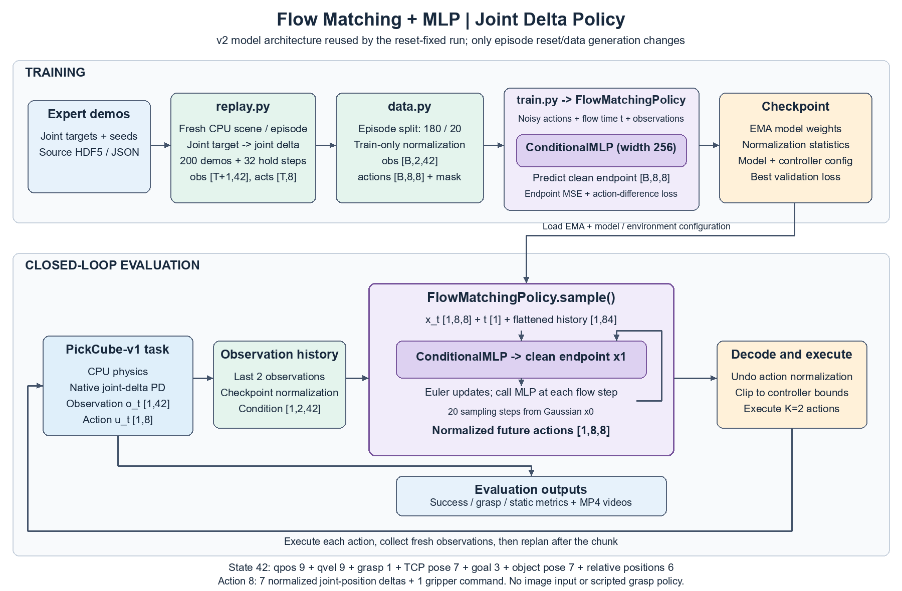
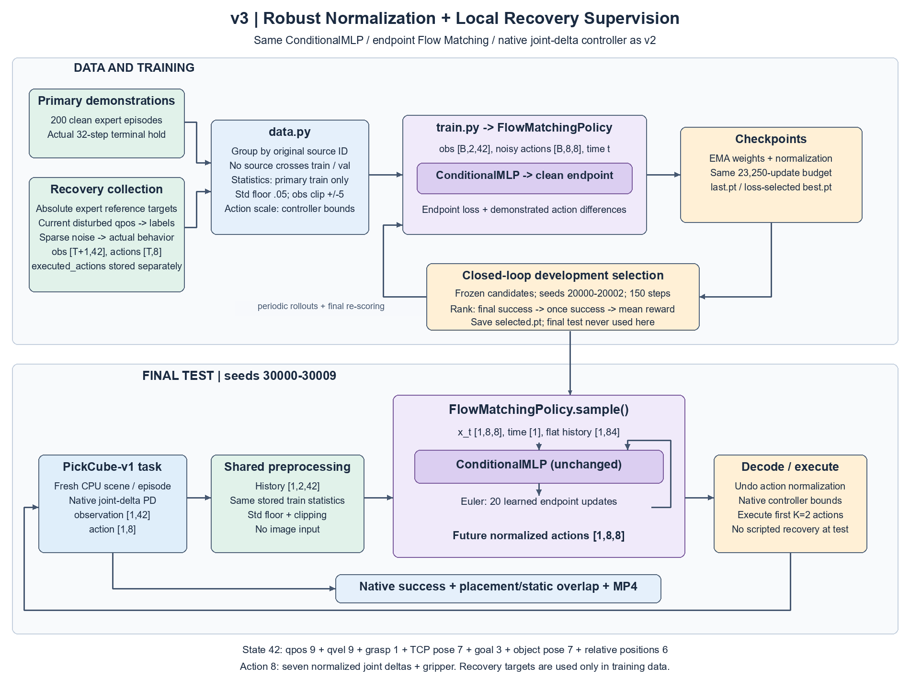
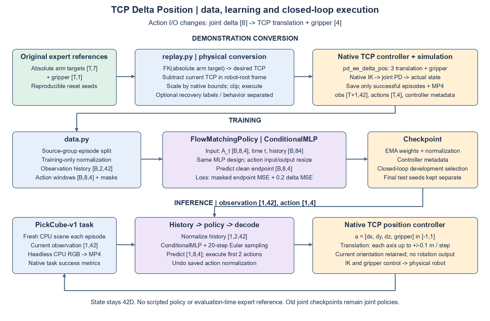

# ManiSkill Action Policy Experiment

使用 ManiSkill 的狀態觀測與動作示範，訓練 Diffusion Policy 與 Flow Matching Policy，再透過模擬成功率與影片評估。

- `data.py`：按完整 episode 切分訓練／驗證集、計算正規化統計並建立觀測與動作視窗，供訓練程式使用。
- `train.py`：訓練策略、追蹤驗證 loss，保存配置、正規化統計與 checkpoint。
- `evaluate.py`：載入 checkpoint，在模擬中執行策略並輸出成功率及 MP4。

## 整體架構：Flow MLP／Joint Delta



[可編輯 SVG 原圖](assets/flow_mlp_joint_delta_v2.svg)。圖示目前 reset 修正版的執行流程；policy 架構與 `flow_mlp_200_delta_v2` 相同。此次 minor revision 沒有更換 MLP、連接方式或 I/O，只改 CPU reset 及重建示範。

Task 每步輸出 42 維狀態；最近兩步正規化後送入 FlowMatchingPolicy。Policy 內的 `ConditionalMLP` 根據帶噪動作、生成時間與觀測預測乾淨動作端點，Euler 採樣產生未來 8 步、每步 8 維的動作；還原尺度後送出前兩步，再重新規劃。8 維動作是 7 個 joint delta commands 與 1 個 gripper command，並非 TCP delta。訓練端以 episode 切分、正規化及示範視窗監督端點與動作差分目標，評估端使用 EMA 權重。模型架構與生成方法定義在 models，實驗只負責組合、訓練及環境互動。

## 產出分類

依產物責任分開管理：benchmark 保存可重用的原始示範與 replay 資料，本實驗保存訓練與策略評估結果。兩邊都先依 task 分類，再依用途與批次區分，新增 task 時沿用相同結構。

```text
experiments/maniskill_action_policy/outputs/<task>/
├── training/<run>/       配置、訓練紀錄與 checkpoint
└── evaluation/<run>/     評估指標與 videos/ 影片
```

訓練透過 `--demo-path` 引用 benchmark 中的資料，不複製一份到實驗目錄。批次名稱應能辨識策略與實驗設定，例如 `flow_matching_2000`；同一次訓練可有多個評估批次。

評估使用哪個模型由 `--checkpoint` 的內容決定，`--output-dir` 只決定儲存位置，不會切換策略。評估目錄名稱應與 checkpoint 對應，實際策略與來源可查 `metrics.json` 的 `policy`、`checkpoint` 欄位。既有目錄若名稱不符，不能只靠資料夾名稱判斷模型。

## 執行前提

以下指令從專案根目錄執行，使用已安裝本專案 editable package 與 ManiSkill 的環境：

```shell
conda activate maniskill
```

資料使用 [ManiSkill replay 工具](../../benchmark/maniskill/README.md) 產生的 `trajectory.h5`，同目錄需保留配對的 `trajectory.json`。以下以既有的 PickCube 50 筆示範為例；換資料時修改 `--demo-path`。目前流程使用狀態觀測，不包含影像編碼器。

## Training

Diffusion Policy：

```shell
python -m experiments.maniskill_action_policy.train --policy diffusion --demo-path benchmark/maniskill/outputs/PickCube-v1/replays/motionplanning/demos_50/trajectory.h5 --output-dir experiments/maniskill_action_policy/outputs/PickCube-v1/training/diffusion_v1 --epochs 200
```

Flow Matching Policy：

```shell
python -m experiments.maniskill_action_policy.train --policy flow_matching --demo-path benchmark/maniskill/outputs/PickCube-v1/replays/motionplanning/demos_50/trajectory.h5 --output-dir experiments/maniskill_action_policy/outputs/PickCube-v1/training/flow_matching_v1 --epochs 200
```

預設自動使用可用的 CUDA，也可指定 `--device cpu` 或 `--device cuda`。其他參數可用以下指令查詢：

```shell
python -m experiments.maniskill_action_policy.train --help
```

每次訓練會在指定目錄保存 `config.json`、`metrics.csv`、驗證 loss 最佳的 `best.pt` 與最後一輪的 `last.pt`。驗證 loss 用來觀察學習趨勢；任務能力需以下面的模擬評估確認，兩種策略的 loss 不宜直接比較。

## Testing：模擬評估與影片

Diffusion Policy：

```shell
python -m experiments.maniskill_action_policy.evaluate --checkpoint experiments/maniskill_action_policy/outputs/PickCube-v1/training/diffusion_v1/best.pt --output-dir experiments/maniskill_action_policy/outputs/PickCube-v1/evaluation/diffusion_v1_repeat --episodes 10
```

Flow Matching Policy：

```shell
python -m experiments.maniskill_action_policy.evaluate --checkpoint experiments/maniskill_action_policy/outputs/PickCube-v1/training/flow_matching_v1/best.pt --output-dir experiments/maniskill_action_policy/outputs/PickCube-v1/evaluation/flow_matching_v1 --episodes 10
```

評估既有的 2000 epochs Flow Matching checkpoint：

```shell
python -m experiments.maniskill_action_policy.evaluate --checkpoint experiments/maniskill_action_policy/outputs/PickCube-v1/training/flow_matching_2000/best.pt --output-dir experiments/maniskill_action_policy/outputs/PickCube-v1/evaluation/flow_matching_2000 --episodes 10
```

評估使用 checkpoint 的 EMA 權重與訓練時的正規化統計。每個評估目錄包含：

- `metrics.json`：各 episode 結果、曾經成功的比例 `success_once_rate` 與結束時成功的比例 `success_at_end_rate`。
- `videos/000000.mp4` 等：每個 episode 的離屏錄影片，下載或直接開啟即可觀看。

目前 Windows 設定採單一環境、CPU 模擬與 CPU RGB 渲染；模型推論仍可使用 CUDA，不開啟 GUI。可用 `--seed` 控制評估 seed、`--inference-steps` 調整採樣步數，完整選項如下：

```shell
python -m experiments.maniskill_action_policy.evaluate --help
```

訓練與評估的 `--output-dir` 都必須是尚未存在的新目錄。重跑時將範例中的 `v1` 改成新的批次名稱，並讓 `--checkpoint` 對應實際訓練結果；所有相對路徑以執行指令時的工作目錄為準。

## 改善抓取後抖動的實驗

此版本比較原本 50 筆資料與新增 200 筆示範。新增資料隨機選取來源軌跡，在模擬器中延續最後的絕對 joint position target 32 步，補錄穩定段的真實觀測；製作方式見 [replay 說明](../../benchmark/maniskill/README.md)。不改動既有資料。

學習流程新增：`--architecture mlp` 的獨立觀測編碼器、`--temporal-loss-weight` 的示範動作差分目標、`--observation-noise` 的正規化觀測擾動，以及 `--observation-std-floor` 的標準差下限。統計仍只使用訓練 episodes；驗證資料不加擾動。本輪實驗明確指定標準差下限為 0.02；預設維持舊版的 1e-6 門檻與常數維度處理，既有 checkpoint 的統計保持原樣。

架構與學習方式對照（原本 50 筆資料）：

```shell
python -m experiments.maniskill_action_policy.train --policy flow_matching --demo-path benchmark/maniskill/outputs/PickCube-v1/replays/motionplanning/demos_50/trajectory.h5 --output-dir experiments/maniskill_action_policy/outputs/PickCube-v1/training/flow_mlp_50_v2 --architecture mlp --hidden-dim 256 --prediction-horizon 8 --action-horizon 2 --temporal-loss-weight 0.2 --observation-noise 0.02 --observation-std-floor 0.02 --lr 0.0003 --epochs 300
```

加入較多示範與末端保持段：

```shell
python -m experiments.maniskill_action_policy.train --policy flow_matching --demo-path benchmark/maniskill/outputs/PickCube-v1/replays/motionplanning/demos_200_hold32/trajectory.h5 --output-dir experiments/maniskill_action_policy/outputs/PickCube-v1/training/flow_mlp_200_hold32_v2 --architecture mlp --hidden-dim 256 --prediction-horizon 8 --action-horizon 2 --flow-prediction sample --flow-solver euler --temporal-loss-weight 0.2 --observation-noise 0.02 --observation-std-floor 0.02 --lr 0.0003 --epochs 150
```

評估時固定 seed 與 10 個 episodes；`--action-horizon` 可覆寫執行長度，以比較重新規劃頻率，不能超過模型的 prediction horizon。省略時使用 checkpoint 設定。

```shell
python -m experiments.maniskill_action_policy.evaluate --checkpoint experiments/maniskill_action_policy/outputs/PickCube-v1/training/flow_mlp_200_hold32_v2/best.pt --output-dir experiments/maniskill_action_policy/outputs/PickCube-v1/evaluation/flow_mlp_200_hold32_v2 --episodes 10 --seed 10000
```

評估的 `metrics.json` 另保存 `action_horizon`、seed、動作差分 RMS，以及環境原生 `is_*` 布林指標的成立比例與是否曾成立。這些指標只用於診斷，不能取代任務成功率；程式不依它們選擇動作。動作差分 RMS 需在相同 controller 與動作尺度下比較。

端點學習模式使用 `--flow-prediction sample --flow-solver euler`，直接監督乾淨動作 x1。對直線 flow path，這相當於將 velocity matching loss 乘上 `(1-t)^2`；採樣仍從 Gaussian 出發，根據模型端點預測積分，最後一步到達所預測端點。此模式的 loss 與原本 velocity 模式不可直接比較。原模式及舊 checkpoint 保持相容；端點模式目前只支援 Euler，避免在 t=1 評估奇異速度。

### Delta 動作表示的訓練與評估

透過 [replay 轉換](../../benchmark/maniskill/README.md) 重新取得 joint delta 示範後，保持模型架構與端點目標，讓模型學習原生 delta controller 動作。controller 設定隨資料 metadata 存進 checkpoint，評估直接使用它，不將 absolute 與 delta 權重混用。

```shell
python -m experiments.maniskill_action_policy.train --policy flow_matching --demo-path benchmark/maniskill/outputs/PickCube-v1/replays/motionplanning/demos_200_delta_hold32/trajectory.h5 --output-dir experiments/maniskill_action_policy/outputs/PickCube-v1/training/flow_mlp_200_delta_v2 --architecture mlp --hidden-dim 256 --prediction-horizon 8 --action-horizon 2 --flow-prediction sample --flow-solver euler --temporal-loss-weight 0.2 --observation-noise 0.02 --observation-std-floor 0.02 --lr 0.0003 --epochs 150
python -m experiments.maniskill_action_policy.evaluate --checkpoint experiments/maniskill_action_policy/outputs/PickCube-v1/training/flow_mlp_200_delta_v2/best.pt --output-dir experiments/maniskill_action_policy/outputs/PickCube-v1/evaluation/flow_mlp_200_delta_v2 --episodes 10 --seed 10000
```

Absolute 與 delta controller 的動作尺度不同，兩者的 command delta RMS 不可直接當作物理抖動改善百分比；任務成功率與環境靜止指標可在相同任務／seed 下比較。

評估另記錄實際機器人 joint velocity RMS（`joint_velocity_rms`）、最長連續成功步數 `max_success_streak` 與結束時連續成功步數 `final_success_streak`，用來區分短暫完成與保持成功。

## 本輪實際結果

本輪以 Flow Matching 為主，在 CPU 物理／CPU 離屏渲染下，以相同 seed 10000～10009 各評估 10 回合、每回合最多 150 步。這是重複使用開發 seed 的探索性比較，不能當作獨立測試集的泛化結論。

| 設定 | 訓練 epochs | 曾成功／結束成功 | 抓取時間比例 |
| --- | ---: | ---: | ---: |
| 原 U-Net、50 筆示範、velocity 目標 | 2000 | 0/10、0/10 | 18.5% |
| MLP、50 筆示範、velocity＋差分目標 | 300 | 0/10、0/10 | 0.0% |
| MLP、200 筆含保持段、absolute 端點目標 | 150 | 0/10、0/10 | 13.8% |
| MLP、200 筆含保持段、delta 端點目標、每兩步重新規劃 | 150 | 0/10、0/10 | 59.9% |
| 同一 delta checkpoint、每步重新規劃 | 同上 | 0/10、0/10 | 65.8% |

抓取時間比例來自環境原生 `is_grasped`，不是成功率，也不代表連續穩定搬運。Delta 版本在這組 seed 中維持抓取的時間較多，但所有版本仍未完成任務，不能宣稱抖動問題已修好。模型依最佳驗證 loss 選取；最佳 epoch 分別為 MLP 50 筆的 287、absolute 200 筆的 98、delta 200 筆的 61，不是最後一輪。

每步重新規劃的對照命令：

```shell
python -m experiments.maniskill_action_policy.evaluate --checkpoint experiments/maniskill_action_policy/outputs/PickCube-v1/training/flow_mlp_200_delta_v2/best.pt --output-dir experiments/maniskill_action_policy/outputs/PickCube-v1/evaluation/flow_mlp_200_delta_v2_h1 --episodes 10 --seed 10000 --action-horizon 1
```

正式結果保存在 `outputs/PickCube-v1/comparisons/flow_v2/results.json`；逐回合指標與影片在各 `evaluation/<run>/`。重跑以上命令須更換新的輸出批次名稱。短暫中途測試的 checkpoint、資料與影片皆使用暫存目錄並已清除。

另外發現示範初始觀測的接觸訊號異常：本輪每份 200 筆資料有 199 筆在初始觀測標記已抓取，且同一 reset seed 單獨重設時曾出現該欄位差異。當時尚未修正；後續已重現並修正 reset 流程（見下節），但舊資料與權重尚未重建，不能認定它就是抓取後抖動的原因。成功／影片檢查只能驗證結果與對齊，無法保證每個觀測欄位都正確。後續需要先處理這項資料品質問題，並收集偏離專家軌跡時的恢復示範，再驗證閉環控制。

## Reset 邊界的資料品質修正

先前修正 CPU reset 生命週期時，policy 架構、模組連接與 I/O 維度皆與前版相同，當時沒有重新訓練；後續重訓另見下節。`evaluate.py` 現在同 replay 一樣使用原生 `reconfiguration_freq=1`，避免沿用上一回合接觸；會檢查 scene 確實重建，並在 metrics 記錄 `reset_strategy`、各回合 `reset_reconfigured` 與 `initial_native_flags`。

原本數據的初始抓取標記異常已重新計數並以模擬重現；普通 reset 與重建 scene reset 的差異僅在該欄位。已用 absolute 與 joint delta 各三筆完整專家回放，以及兩回合短評估確認新 reset 流程；這些是暫存管線測試，不能解讀為模型任務成功率改善。測試產物已清除。

上方舊示範、checkpoint 與比較結果保留原樣；修正後資料與重訓另存新批次，見下節。使用舊 checkpoint 跑修正後評估時，應另建批次，並注意 reset 語意已不同，不能當作原有結果的完全重現。正式資料重建方式見 [benchmark README](../../benchmark/maniskill/README.md)。尚無證據證明這項初始觀測問題是抓取後抖動的主要原因。

## Reset 修正後的重訓與評估

沿用 `flow_mlp_200_delta_v2` 的 200 筆來源軌跡、shuffle seed 42、180／20 episode 切分、模型與全部訓練超參數。使用修正後的 replay 重建 `demos_200_delta_hold32_reset_fixed`，初始抓取標記為 0/200、22,022 個動作、所有最後 32 步保持成功，資料稽核保存於該批次 `reset_audit.json`。原生 scene 重建會造成少量後續物理數值差異，因此這是 reset 流程修正版的比較，不能視為只手動修改單一標記的實驗。

訓練（150 epochs，seed 0）：

```shell
python -m experiments.maniskill_action_policy.train --policy flow_matching --demo-path benchmark/maniskill/outputs/PickCube-v1/replays/motionplanning/demos_200_delta_hold32_reset_fixed/trajectory.h5 --output-dir experiments/maniskill_action_policy/outputs/PickCube-v1/training/flow_mlp_200_delta_reset_fixed --architecture mlp --hidden-dim 256 --prediction-horizon 8 --action-horizon 2 --flow-prediction sample --flow-solver euler --temporal-loss-weight 0.2 --observation-noise 0.02 --observation-std-floor 0.02 --lr 0.0003 --epochs 150 --seed 0
```

新 checkpoint 的評估：

```shell
python -m experiments.maniskill_action_policy.evaluate --checkpoint experiments/maniskill_action_policy/outputs/PickCube-v1/training/flow_mlp_200_delta_reset_fixed/best.pt --output-dir experiments/maniskill_action_policy/outputs/PickCube-v1/evaluation/flow_mlp_200_delta_reset_fixed --episodes 10 --seed 10000
```

另以相同修正版 reset 和十個 seed 重測舊 checkpoint，作為評估流程相同的對照：

```shell
python -m experiments.maniskill_action_policy.evaluate --checkpoint experiments/maniskill_action_policy/outputs/PickCube-v1/training/flow_mlp_200_delta_v2/best.pt --output-dir experiments/maniskill_action_policy/outputs/PickCube-v1/evaluation/flow_mlp_200_delta_v2_reset_fixed --episodes 10 --seed 10000
```

兩組評估都執行前兩步再重新規劃，每回合最多 150 步、20 個 Euler 採樣步數。正式影片與指標保存於各評估批次；既有批次不覆寫，重跑請更換輸出名稱。

### Reset 修正版實際結果

已完成 150 epochs／23,250 次更新。最佳 EMA checkpoint 為第 68 個 epoch（10,540 次更新），驗證 loss 為 0.000770917；最後一輪保存在 last.pt，正式評估使用 best.pt。

| 權重與評估流程 | 曾成功／結束成功 | 抓取時間比例 | 靜止時間比例 |
| --- | ---: | ---: | ---: |
| 舊 checkpoint＋舊 reset（前次結果） | 0/10、0/10 | 59.9% | 52.9% |
| 舊 checkpoint＋修正 reset | 0/10、0/10 | 61.1% | 54.3% |
| 修正資料重訓＋修正 reset | 0/10、0/10 | 59.7% | 60.3% |

兩組修正版評估的十回合初始抓取標記全部為 false，scene 都確實重建。新資料與評估的 reset 問題已排除，但重訓後仍無任務成功，未證明抓取／搬運能力改善；不能以較高靜止比例宣稱抖動已解決，因為靜止可能發生在未完成任務時。這也不足以把抓取後失敗歸因於原本那一個初始標記。

比較報告保存在 `outputs/PickCube-v1/comparisons/reset_fixed/results.json`。新模型影片位於 `outputs/PickCube-v1/evaluation/flow_mlp_200_delta_reset_fixed/videos/`，每回合都有已驗證的非空 MP4、151 個影格與合理播放時長；逐回合結果見同批次 `metrics.json`。本次沒有建立額外測試程式或暫存測試資料，保留正式示範、checkpoint、評估影片與結果。

## v3：正規化、恢復監督與閉環模型選擇



[可編輯 SVG](assets/flow_recovery_v3.svg)。核心 MLP architecture 與前版相同（[前版架構圖](assets/flow_mlp_joint_delta_v2.png)），仍是 42 維 state、兩步觀測、八步預測、八維 joint delta＋gripper action，每次執行兩步；沒有換網路、改 controller 或加入推論抓取規則。因為資料與訓練流程新增來源分組、恢復標籤及閉環模型選擇，上圖另畫出新的整體資料流。

- `data.py` 新增 `load_training_episodes()`：載入 primary 與 recovery 資料，以原始來源 ID 分組切分，防止同來源的不同版本跨 train／validation。加入恢復資料後為 340／40 條軌跡，仍對應相同 180／20 個來源群組。未完成或未標記教師標籤語意的恢復資料會被拒絕。
- `normalize_observations()` 由訓練、驗證與 evaluate 共用。此版設定 observation std floor 0.05、正規化後 clip 到 ±5；資料擾動後也使用相同 clip。Action 的中心與尺度取自環境原生 controller 邊界，不使用窄小示範範圍作推論限制。統計只由 primary 的訓練 episodes 計算，因此兩個新版本的正規化統計完全相同。
- `train.py` 可用 `--recovery-path` 加入修正標籤，仍使用 endpoint Flow Matching 與動作差分目標。32 步保持段由真實模擬資料監督，不把超出軌跡的 mask 位置當作虛構成功資料。
- `--rollout-every`、`--rollout-episodes`、`--rollout-seed` 與明確的 `--rollout-output-dir` 啟用閉環開發評估，約每 8,000 次更新及結束時評估三個固定開發 seed。`best_rollout.pt` 依結束成功率、曾成功率、平均 reward 的順序選取；若都未成功，reward 只是選擇 fallback，不代表學會任務。原本依 loss 選出的 `best.pt` 與最後的 `last.pt` 仍保留供比較。
- `evaluate.py` 額外記錄 `placement_and_static_fraction`，直接檢查物件到位和機器人靜止同時成立的時間比例；任務成功判定完全沿用 ManiSkill，不用此指標或抓取旗標干預 action。

固定實驗協定先存於 `outputs/PickCube-v1/comparisons/robust_recovery_v3/protocol.json`。正規化版與恢復版都使用相同架構、optimizer、loss、seed 0 與 23,250 次更新。`--epochs 150` 是上限；加入恢復資料後每輪較長，因此會先達更新預算，不能把兩版都稱為跑完 150 epochs。開發 seed 是 20000～20002，最終測試 seed 是 30000～30009；最終測試不參與選權重或再調參。十個 seed 仍只是小樣本，不能推廣為完整 benchmark 結論。

正規化對照版（乾淨資料）：

```shell
python -m experiments.maniskill_action_policy.train --policy flow_matching --demo-path benchmark/maniskill/outputs/PickCube-v1/replays/motionplanning/demos_200_delta_hold32_reset_fixed/trajectory.h5 --output-dir experiments/maniskill_action_policy/outputs/PickCube-v1/training/flow_norm_v3 --architecture mlp --hidden-dim 256 --prediction-horizon 8 --action-horizon 2 --flow-prediction sample --flow-solver euler --temporal-loss-weight 0.2 --observation-noise 0.02 --observation-std-floor 0.05 --observation-clip 5 --action-normalization bounds --lr 0.0003 --epochs 150 --max-steps 23250 --seed 0 --rollout-every 8000 --rollout-episodes 3 --rollout-seed 20000 --rollout-output-dir experiments/maniskill_action_policy/outputs/PickCube-v1/evaluation/flow_norm_v3_development
```

恢復版（相同設定，加入 recovery）：

```shell
python -m experiments.maniskill_action_policy.train --policy flow_matching --demo-path benchmark/maniskill/outputs/PickCube-v1/replays/motionplanning/demos_200_delta_hold32_reset_fixed/trajectory.h5 --recovery-path benchmark/maniskill/outputs/PickCube-v1/replays/motionplanning/recovery_180_delta_v3/trajectory.h5 --output-dir experiments/maniskill_action_policy/outputs/PickCube-v1/training/flow_recovery_v3 --architecture mlp --hidden-dim 256 --prediction-horizon 8 --action-horizon 2 --flow-prediction sample --flow-solver euler --temporal-loss-weight 0.2 --observation-noise 0.02 --observation-std-floor 0.05 --observation-clip 5 --action-normalization bounds --lr 0.0003 --epochs 150 --max-steps 23250 --seed 0 --rollout-every 8000 --rollout-episodes 3 --rollout-seed 20000 --rollout-output-dir experiments/maniskill_action_policy/outputs/PickCube-v1/evaluation/flow_recovery_v3_development
```

兩版最終測試（訓練與開發選擇完成後）：

```shell
python -m experiments.maniskill_action_policy.evaluate --checkpoint experiments/maniskill_action_policy/outputs/PickCube-v1/evaluation/flow_norm_v3_selection/selected.pt --output-dir experiments/maniskill_action_policy/outputs/PickCube-v1/evaluation/flow_norm_v3_test --episodes 10 --seed 30000
python -m experiments.maniskill_action_policy.evaluate --checkpoint experiments/maniskill_action_policy/outputs/PickCube-v1/evaluation/flow_recovery_v3_selection/selected.pt --output-dir experiments/maniskill_action_policy/outputs/PickCube-v1/evaluation/flow_recovery_v3_test --episodes 10 --seed 30000
```

舊 reset-fixed 模型也在同一組新 seed 評估，避免拿不同 seed 的舊 0% 直接比較：

```shell
python -m experiments.maniskill_action_policy.evaluate --checkpoint experiments/maniskill_action_policy/outputs/PickCube-v1/training/flow_mlp_200_delta_reset_fixed/best.pt --output-dir experiments/maniskill_action_policy/outputs/PickCube-v1/evaluation/flow_reset_fixed_v2_v3_test --episodes 10 --seed 30000
```

與舊版的比較同時包含正規化與閉環選權重的流程修正，不能分別歸因給單一設定；兩個新版本之間則只增加恢復資料，架構、正規化統計與更新預算固定。發展評估點落在 epoch 邊界，因此實際更新數略有不同，詳見各步 metrics。

訓練的 `save_checkpoint()` 以暫存檔原子替換權重，對 Windows 短暫 reader lock 有限次重試；這不改 loss、模型或資料。開發評估由訓練程式同步啟動，評估期間暫停更新權重。監看進度應讀 metrics.csv／config.json，避免反覆開啟正在寫入的 last.pt。本輪正規化對照曾因監看讀檔鎖中斷，已移除該未完成批次並從相同 seed 完整重跑；過程記錄於比較目錄 interruption.json，未將中斷結果混入正式比較。

### 完整時域的權重選擇與成功判讀

`evaluate.py` 預設在成功後繼續執行，直到指定時域或環境截斷；失敗終止仍會停止。這樣 `success_at_end` 才能區分短暫成功與結束時成功。`--stop-on-success` 只供重現舊診斷，不用於本輪正式選擇或測試。最長／最後連續成功步數仍須一起看，結束成功不代表全程保持。

本輪途中發現舊評估在原生 success termination 立即停止，因此較早的 development 批次不能用來證明成功保持。梯度訓練不受此問題影響；訓練結束後改由 `select_checkpoint.py` 將 loss-best、最後一輪與訓練中 rollout-best 三份凍結候選全部重新評估。它複製候選到新批次、檢查每回合跑滿指定時域，依結束成功率、曾成功率、平均 reward 排序，輸出 `selection.json`、`selected.pt` 與各候選影片。這是三份可用權重的重選，不代表搜尋過所有中間權重。

在已安裝本專案 editable package 的 `maniskill` 環境執行，訓練必須先結束；輸出目錄必須不存在：

```shell
conda activate maniskill
python -m experiments.maniskill_action_policy.select_checkpoint --checkpoints experiments/maniskill_action_policy/outputs/PickCube-v1/training/flow_norm_v3/best.pt experiments/maniskill_action_policy/outputs/PickCube-v1/training/flow_norm_v3/last.pt experiments/maniskill_action_policy/outputs/PickCube-v1/training/flow_norm_v3/best_rollout.pt --output-dir experiments/maniskill_action_policy/outputs/PickCube-v1/evaluation/flow_norm_v3_selection --episodes 3 --seed 20000 --max-episode-steps 150
python -m experiments.maniskill_action_policy.select_checkpoint --checkpoints experiments/maniskill_action_policy/outputs/PickCube-v1/training/flow_recovery_v3/best.pt experiments/maniskill_action_policy/outputs/PickCube-v1/training/flow_recovery_v3/last.pt experiments/maniskill_action_policy/outputs/PickCube-v1/training/flow_recovery_v3/best_rollout.pt --output-dir experiments/maniskill_action_policy/outputs/PickCube-v1/evaluation/flow_recovery_v3_selection --episodes 3 --seed 20000 --max-episode-steps 150
```

完成後再執行上方指向 `evaluation/<run>_selection/selected.pt` 的最終測試命令。候選逐回合結果見各 `candidate_XX/evaluation/metrics.json`，影片集中於其 `videos`；選擇依據及來源見 `selection.json`。
### v3 實際結果與限制

兩個新版本均完成 23,250 次 optimizer 更新：正規化版 150 epochs，恢復版在第 80 epoch 達預算。兩版 checkpoint 內的 model_config、primary 訓練切分、正規化 tensors 已逐項核對相同；恢復資料來源群組與驗證集無重疊。訓練後用完整 150 步的三個開發 seed 重評三份候選，正規化版選第 58 epoch／8,990 更新，恢復版選第 38 epoch／11,134 更新；兩者恰好都是 loss-best，但選擇依據是重新跑過的閉環開發結果，沒有使用最終測試 seed。

下表為三組在相同新 seed 30000～30009、每回合 150 步的正式測試；所有成功後皆繼續執行，沒有提前停止：

| 模型 | 曾成功 | 結束成功 | 抓取時間比例 | 到位且靜止比例 | 平均 reward |
| --- | ---: | ---: | ---: | ---: | ---: |
| 前版 reset 修正模型 | 1/10 | 1/10 | 70.7% | 5.3% | 296.62 |
| v3 正規化＋閉環選權重 | 0/10 | 0/10 | 46.2% | 0.0% | 207.77 |
| v3 同上＋局部恢復示範 | 4/10 | 2/10 | 71.9% | 12.2% | 351.24 |

恢復版的 seed 30005、30009 在結束前分別連續成功 77、76 步；seed 30002、30003 曾連續成功 28、2 步，但結束失敗。能完成部分搬運與保持，仍有成功後失敗，不能宣稱抓取後抖動或閉環穩定性已解決。單改正規化的版本在這批 seed 更差；防止數值放大的機制已實作，不代表已找出失敗主因。先前舊 seed 的 0/10 與這次新 seed 的 1/10 不矛盾，不能把不同 seed 的結果直接當成修改效果。

對先前問題的處理與目前證據：

| 問題 | 本輪處理 | 尚存限制 |
| --- | --- | --- |
| 離線 loss 低但閉環失敗 | 加入真實閉環開發選擇，開發與最終測試分離 | 低 loss 仍不等於成功；恢復版結束成功僅 2/10 |
| 末端成功保持示範不足 | 使用已補錄並稽核的真實 32 步保持段，恢復資料也保留此段 | 沒有證明單靠保持段就能修復模型 |
| 微小標準差放大偏差 | 共用 std floor、clip 與 native action bounds，訓練和推論一致 | 正規化對照無成功，不能稱為任務改善 |
| 到位與靜止未同時成立 | 增加交集指標，成功後繼續跑完整時域 | 恢復版交集比例提高，但仍有短暫成功後失敗 |
| 缺少偏離軌跡後修正 | 180 筆受擾示範、2,133 次局部擾動；教師標籤與實際行為分開 | 不是從模型實際失敗狀態蒐集，未涵蓋嚴重偏離或任意掉落 |
| 比較同時改太多因素 | 固定架構、controller、loss、primary split、統計與更新預算；兩新版本只增加恢復資料 | 舊版對正規化版仍同時改正規化與選權重；只有一個訓練 seed、十個測試 seed |

正式機器可讀結果為 `outputs/PickCube-v1/comparisons/robust_recovery_v3/results.json`，協定與版本在同目錄的 `protocol.json`、`versions.json`；各候選的選擇過程見 `evaluation/<run>_selection/selection.json`。這是探索性小樣本結果，沒有根據最終測試再調參或挑選權重。

恢復版影片：

- [結束成功：seed 30005](outputs/PickCube-v1/evaluation/flow_recovery_v3_test/videos/000005.mp4)
- [結束成功：seed 30009](outputs/PickCube-v1/evaluation/flow_recovery_v3_test/videos/000009.mp4)
- [短暫成功後失敗：seed 30002](outputs/PickCube-v1/evaluation/flow_recovery_v3_test/videos/000002.mp4)

已重新驗證三組共 30 段正式 MP4，皆非空、151 影格、7.55 秒；18 個凍結候選開發回合都執行完整 150 步。資料分組、邊界 mask、有限值補齊、正規化 clipping 與 Windows 權重 reader-lock 重試已做針對性驗證。暫存測試資源和中斷的未完成訓練批次已清除，保留正式資料、訓練結果、選權重結果與交付影片。
## v4：TCP delta position



[可編輯 SVG](assets/flow_tcp_delta_v4.svg)。此版 task observation 仍為 42 維，兩步 observation history；action 改為四維 `[delta_x, delta_y, delta_z, gripper]`，使用 ManiSkill 原生 `pd_ee_delta_pos`。Translation 沿 robot root 座標軸，每軸正規化 command `[-1,1]` 對應最多 ±0.1 m，從當下 TCP 位置計算目標；不預測旋轉，原生位置 controller 保留當下姿態並用 IK 產生 joint targets。

核心網路仍是 `models/policy/action_policy/networks.py` 的 `ConditionalMLP`，由 `FlowMatchingPolicy` 呼叫；網路設計、hidden width 與 observation encoder 不變，動作相關輸入／輸出維度由八維改成四維。因此重畫整體 I/O 架構，舊八維 checkpoint 不能當作 TCP 權重。模型從新資料讀取 action 維度，`train.py` 將 controller 存入 checkpoint，`evaluate.py` 直接依其重建環境，不需要另外指定或覆寫 controller。

此輪只更換 action 表示與必要的資料轉換；沿用 v3 的 endpoint loss、差分權重 0.2、normalization、prediction horizon 8 與 action horizon 2，沒有加入 scripted policy。差分仍是 command sequence 的差分，不是實際 TCP 加速度，也不保證兩次重新規劃之間連續。TCP 示範需要透過 [benchmark 回放流程](../../benchmark/maniskill/README.md) 實際重建，不能從舊 joint 動作擷取幾個維度。新資料與舊 controller 的 recovery 不能混合，若需 TCP recovery 必須以同一新 controller 重新收集。

環境與資料完成後，正式訓練命令如下；此命令會啟動完整訓練，不是管線短測試：

```shell
conda activate maniskill
python -m experiments.maniskill_action_policy.train --policy flow_matching --demo-path benchmark/maniskill/outputs/PickCube-v1/replays/motionplanning/demos_200_tcp_delta_hold32_v4/trajectory.h5 --output-dir experiments/maniskill_action_policy/outputs/PickCube-v1/training/flow_tcp_delta_v4 --architecture mlp --hidden-dim 256 --prediction-horizon 8 --action-horizon 2 --flow-prediction sample --flow-solver euler --temporal-loss-weight 0.2 --observation-noise 0.02 --observation-std-floor 0.05 --observation-clip 5 --action-normalization bounds --lr 0.0003 --epochs 300 --max-steps 23250 --seed 0 --rollout-every 8000 --rollout-episodes 3 --rollout-seed 40000 --rollout-output-dir experiments/maniskill_action_policy/outputs/PickCube-v1/evaluation/flow_tcp_delta_v4_development
```

訓練完成後重新評估凍結候選，再測試及錄影。開發與測試使用分開的 seed；輸出均需為不存在的新目錄：

```shell
python -m experiments.maniskill_action_policy.select_checkpoint --checkpoints experiments/maniskill_action_policy/outputs/PickCube-v1/training/flow_tcp_delta_v4/best.pt experiments/maniskill_action_policy/outputs/PickCube-v1/training/flow_tcp_delta_v4/last.pt experiments/maniskill_action_policy/outputs/PickCube-v1/training/flow_tcp_delta_v4/best_rollout.pt --output-dir experiments/maniskill_action_policy/outputs/PickCube-v1/evaluation/flow_tcp_delta_v4_selection --episodes 3 --seed 40000 --max-episode-steps 150
python -m experiments.maniskill_action_policy.evaluate --checkpoint experiments/maniskill_action_policy/outputs/PickCube-v1/evaluation/flow_tcp_delta_v4_selection/selected.pt --output-dir experiments/maniskill_action_policy/outputs/PickCube-v1/evaluation/flow_tcp_delta_v4_test --episodes 10 --seed 50000 --max-episode-steps 150
```

模型選擇依據見 selection 目錄的 `selection.json`；正式測試結果見 test 目錄的 `metrics.json`，MP4 集中於其 `videos/`。本次 TCP 動作變更的管線驗證與資料狀態另見下方，不以短測試表示已學會任務。
若延續 v3 的恢復示範方法，需重新收集 TCP 版本，再在訓練命令加入對應 `--recovery-path`；不能使用舊 joint recovery：

```shell
python -m benchmark.maniskill.replay --traj-path benchmark/maniskill/outputs/PickCube-v1/motionplanning/trajectory.h5 --source-manifest benchmark/maniskill/outputs/PickCube-v1/replays/motionplanning/demos_200_tcp_delta_hold32_v4/manifest.json --output-dir benchmark/maniskill/outputs/PickCube-v1/replays/motionplanning/recovery_180_tcp_delta_v4 --count 180 --hold-steps 32 --control-mode pd_ee_delta_pos --video-count 3 --perturbation-std 0.1 --perturbation-probability 0.15 --perturbation-seed 123
```

此命令是另行收集的用法，並不表示已產出該恢復批次。完成後，對上方 train 命令增加 `--recovery-path benchmark/maniskill/outputs/PickCube-v1/replays/motionplanning/recovery_180_tcp_delta_v4/trajectory.h5`，並為 training、development、selection、test 更換新的批次名稱。程式會檢查兩份資料的環境／controller 一致，按原始來源群組切分，正規化仍只用 primary training episodes。
### TCP 版本目前的驗證狀態

正式 primary 資料已重建為 200 筆／22,022 個四維動作，來源順序與前版 reset-fixed joint 批次完全一致，初始抓取標記全部正確、全部最後 32 步成功。以記錄的 TCP 位置獨立重算全部動作標籤，最大正規化誤差約 1.79e-6。稽核見 benchmark 該批次的 `tcp_audit.json`；[示範影片](../../benchmark/maniskill/outputs/PickCube-v1/replays/motionplanning/demos_200_tcp_delta_hold32_v4/videos/000000.mp4)呈現的是專家回放，不是已訓練 policy。

原生 CPU TCP IK、CUDA 模型運算、TCP clean／recovery 示範收集、四維 Flow Matching 短訓練與 checkpoint 評估錄影均通過；Diffusion Policy 與 Flow Matching Policy 的四維 loss、反向傳播及採樣也通過。另確認舊八維 joint 回放與舊 checkpoint 評估仍可使用，`pip check` 無破損依賴。測試使用暫存目錄，已清除其資料、權重及影片；正式示範與交付影片保留。

TCP 正式訓練與自動評估已完成：150 epochs／23,250 次更新，使用 primary 200 筆示範、CUDA、seed 0；沒有加入 recovery。配置與進度保存在 outputs/PickCube-v1/training/flow_tcp_delta_v4/，協定、版本與正式結果保存在 outputs/PickCube-v1/comparisons/tcp_delta_v4/。凍結權重選擇及十回合測試均已完成，結果見下節。v4 當時未加入 TCP recovery；後續恢復資料與對照見 v5。

### TCP 正式訓練與測試結果

訓練在第 150 epoch 達到 23,250 次更新預算。三份凍結候選以開發 seed 40000～40002 重新評估，選出第 145 epoch／22,475 次更新的 EMA 權重，保存於 `outputs/PickCube-v1/evaluation/flow_tcp_delta_v4_selection/selected.pt`。選擇依據見同批次 `selection.json`；開發回合的成功率為 2/3，不當作最終測試成績。

在未參與選權重的 seed 50000～50009，單環境 CPU 模擬／離屏渲染、CUDA 推論，每回合 150 步、20 步 Euler 採樣：

| 指標 | 結果 |
| --- | ---: |
| 曾成功 | 2/10（20%） |
| 結束成功 | 2/10（20%） |
| 平均 reward | 350.62 |
| 抓取時間比例 | 71.7% |
| 到位且靜止時間比例 | 11.3% |

seed 50008、50009 分別連續成功 77、93 步直到結束；其餘八回合未達原生任務成功條件。TCP 版本能完成部分回合，但尚不能稱為可靠控制。此輪沒有 TCP recovery，且最終 seed 與前版不同，不能直接以舊版成功率宣稱 TCP 優於或劣於 joint delta。

- [成功影片：seed 50008](outputs/PickCube-v1/evaluation/flow_tcp_delta_v4_test/videos/000008.mp4)
- [成功影片：seed 50009](outputs/PickCube-v1/evaluation/flow_tcp_delta_v4_test/videos/000009.mp4)
- [未成功影片：seed 50000](outputs/PickCube-v1/evaluation/flow_tcp_delta_v4_test/videos/000000.mp4)
- [逐回合評估指標](outputs/PickCube-v1/evaluation/flow_tcp_delta_v4_test/metrics.json)
- [正式結果與驗證](outputs/PickCube-v1/comparisons/tcp_delta_v4/results.json)

十回合皆在成功後繼續執行到 150 步，初始抓取標記全部正常；十段 MP4 已重新驗證非空、每段 151 影格與 7.55 秒。這些是正式模型與交付影片，予以保留；本次檢查沒有建立額外暫存測試產物。

## v5：差分 loss 與 TCP recovery 對照

兩個新版本的架構與前一版本相同，沿用 [v4 整體架構圖](assets/flow_tcp_delta_v4.png) 與 [可編輯來源](assets/flow_tcp_delta_v4.svg)：42 維 state、兩步歷史、ConditionalMLP width 256、四維 TCP delta＋gripper、八步預測／執行兩步。圖中差分權重 0.2 對應 baseline 與 recovery；no-temporal 版本移除此 loss 項，網路及推論連接不變。Recovery 使用圖中已標示的 optional recovery labels／behavior 分流及 source-group split。

| 版本 | 差分權重 | 示範 | 改動目的 |
| --- | ---: | --- | --- |
| baseline：既有 flow_tcp_delta_v4 | 0.2 | primary 200 筆 | 同一組新 seed 的對照 |
| flow_tcp_no_temporal_v5 | 0 | 相同 primary | 單獨檢查差分項是否有幫助 |
| flow_tcp_recovery_v5 | 0.2 | primary＋TCP recovery | 單獨檢查局部恢復監督是否有幫助 |

兩個新模型都從 seed 0 重訓，固定 primary 切分、正規化統計、optimizer、learning rate、觀測擾動與 23,250 次更新預算；加入 recovery 後每輪資料較多，因此不以相同 epochs 當作相同計算量。恢復資料與原軌跡按來源群組切分，統計仍只由 primary training episodes 計算。不同 loss 權重與資料分布的 validation loss 不當共同分數。

本輪協定先存於 `outputs/PickCube-v1/comparisons/tcp_loss_recovery_v5/protocol.json`。三組共同使用 development seed 60000～60002、final test seed 70000～70009，皆跑完整 150 步。為讓候選規則一致，訓練結束後三組只從 `best.pt`、`last.pt` 兩份凍結候選重新選權重，排除曾在舊開發 seed 選出的 baseline rollout-best；最終測試不參與選擇。舊 v4 在 seed 50000～50009 的 20% 不直接拿來當本輪對照成績。

在已安裝 editable project 與 ManiSkill 的 `maniskill` 環境、專案根目錄執行；所有輸出目錄必須是新批次，已存在時請同步更換名稱。

TCP recovery 收集：

```shell
conda activate maniskill
python -m benchmark.maniskill.replay --traj-path benchmark/maniskill/outputs/PickCube-v1/motionplanning/trajectory.h5 --source-manifest benchmark/maniskill/outputs/PickCube-v1/replays/motionplanning/demos_200_tcp_delta_hold32_v4/manifest.json --output-dir benchmark/maniskill/outputs/PickCube-v1/replays/motionplanning/recovery_180_tcp_delta_v5 --count 180 --hold-steps 32 --control-mode pd_ee_delta_pos --video-count 3 --perturbation-std 0.1 --perturbation-probability 0.15 --perturbation-seed 123
```

兩組訓練：

```shell
python -m experiments.maniskill_action_policy.train --policy flow_matching --demo-path benchmark/maniskill/outputs/PickCube-v1/replays/motionplanning/demos_200_tcp_delta_hold32_v4/trajectory.h5 --output-dir experiments/maniskill_action_policy/outputs/PickCube-v1/training/flow_tcp_no_temporal_v5 --architecture mlp --hidden-dim 256 --prediction-horizon 8 --action-horizon 2 --flow-prediction sample --flow-solver euler --temporal-loss-weight 0 --observation-noise 0.02 --observation-std-floor 0.05 --observation-clip 5 --action-normalization bounds --lr 0.0003 --epochs 300 --max-steps 23250 --seed 0 --device cuda --rollout-every 8000 --rollout-episodes 3 --rollout-seed 60000 --rollout-output-dir experiments/maniskill_action_policy/outputs/PickCube-v1/evaluation/flow_tcp_no_temporal_v5_development
python -m experiments.maniskill_action_policy.train --policy flow_matching --demo-path benchmark/maniskill/outputs/PickCube-v1/replays/motionplanning/demos_200_tcp_delta_hold32_v4/trajectory.h5 --recovery-path benchmark/maniskill/outputs/PickCube-v1/replays/motionplanning/recovery_180_tcp_delta_v5/trajectory.h5 --output-dir experiments/maniskill_action_policy/outputs/PickCube-v1/training/flow_tcp_recovery_v5 --architecture mlp --hidden-dim 256 --prediction-horizon 8 --action-horizon 2 --flow-prediction sample --flow-solver euler --temporal-loss-weight 0.2 --observation-noise 0.02 --observation-std-floor 0.05 --observation-clip 5 --action-normalization bounds --lr 0.0003 --epochs 300 --max-steps 23250 --seed 0 --device cuda --rollout-every 8000 --rollout-episodes 3 --rollout-seed 60000 --rollout-output-dir experiments/maniskill_action_policy/outputs/PickCube-v1/evaluation/flow_tcp_recovery_v5_development
```

訓練完成後，三組共同重選權重：

```shell
python -m experiments.maniskill_action_policy.select_checkpoint --checkpoints experiments/maniskill_action_policy/outputs/PickCube-v1/training/flow_tcp_delta_v4/best.pt experiments/maniskill_action_policy/outputs/PickCube-v1/training/flow_tcp_delta_v4/last.pt --output-dir experiments/maniskill_action_policy/outputs/PickCube-v1/evaluation/flow_tcp_baseline_v5_selection --episodes 3 --seed 60000 --max-episode-steps 150
python -m experiments.maniskill_action_policy.select_checkpoint --checkpoints experiments/maniskill_action_policy/outputs/PickCube-v1/training/flow_tcp_no_temporal_v5/best.pt experiments/maniskill_action_policy/outputs/PickCube-v1/training/flow_tcp_no_temporal_v5/last.pt --output-dir experiments/maniskill_action_policy/outputs/PickCube-v1/evaluation/flow_tcp_no_temporal_v5_selection --episodes 3 --seed 60000 --max-episode-steps 150
python -m experiments.maniskill_action_policy.select_checkpoint --checkpoints experiments/maniskill_action_policy/outputs/PickCube-v1/training/flow_tcp_recovery_v5/best.pt experiments/maniskill_action_policy/outputs/PickCube-v1/training/flow_tcp_recovery_v5/last.pt --output-dir experiments/maniskill_action_policy/outputs/PickCube-v1/evaluation/flow_tcp_recovery_v5_selection --episodes 3 --seed 60000 --max-episode-steps 150
```

全部模型選定後再做最終評估：

```shell
python -m experiments.maniskill_action_policy.evaluate --checkpoint experiments/maniskill_action_policy/outputs/PickCube-v1/evaluation/flow_tcp_baseline_v5_selection/selected.pt --output-dir experiments/maniskill_action_policy/outputs/PickCube-v1/evaluation/flow_tcp_baseline_v5_test --episodes 10 --seed 70000 --max-episode-steps 150 --device cuda
python -m experiments.maniskill_action_policy.evaluate --checkpoint experiments/maniskill_action_policy/outputs/PickCube-v1/evaluation/flow_tcp_no_temporal_v5_selection/selected.pt --output-dir experiments/maniskill_action_policy/outputs/PickCube-v1/evaluation/flow_tcp_no_temporal_v5_test --episodes 10 --seed 70000 --max-episode-steps 150 --device cuda
python -m experiments.maniskill_action_policy.evaluate --checkpoint experiments/maniskill_action_policy/outputs/PickCube-v1/evaluation/flow_tcp_recovery_v5_selection/selected.pt --output-dir experiments/maniskill_action_policy/outputs/PickCube-v1/evaluation/flow_tcp_recovery_v5_test --episodes 10 --seed 70000 --max-episode-steps 150 --device cuda
```

各批次的 `metrics.json` 保存逐回合指標，影片集中於其 `videos/`；比較結果完成後存入 `outputs/PickCube-v1/comparisons/tcp_loss_recovery_v5/results.json`。本輪正式訓練與測試已完成，結果見下節；不以中途 loss 或短回放判斷哪組較好。只有一個訓練 seed 與十個最終測試 seed，結論仍屬探索性。

### v5 正式對照結果

兩個新版本均完成 23,250 次更新：no-temporal 為 150 epochs，recovery 為第 80 epoch 達預算。已核對三組的 primary 切分、正規化 tensors、核心網路及 optimizer 設定一致；no-temporal 只改差分權重，recovery 只增加同 controller 的恢復資料。恢復版 180 筆包含 2,144 次擾動，教師標籤獨立重算誤差約 1.79e-6，來源群組沒有 train／validation 洩漏；完整稽核見 benchmark 批次的 `recovery_audit.json`。

三組共同在 development seed 60000～60002 重選，皆選出最後一輪權重：baseline 與 no-temporal 為第 150 epoch，recovery 為第 80 epoch，皆為 23,250 次更新。選擇時只使用固定的 loss-best／final 兩份候選，不使用最終測試成績。

在同一組未參與選擇的 seed 70000～70009，每回合 150 步、20 步 Euler 採樣、CPU 物理／離屏 RGB 渲染及 CUDA 推論：

| 版本 | 曾成功 | 結束成功 | 到位且靜止比例 | 平均 reward |
| --- | ---: | ---: | ---: | ---: |
| TCP baseline，差分權重 0.2 | 3/10 | 2/10 | 9.1% | 325.01 |
| 移除差分項，權重 0 | 3/10 | 0/10 | 4.1% | 322.82 |
| 原 loss＋TCP recovery，權重 0.2 | 9/10 | 9/10 | 49.5% | 481.20 |

No-temporal 的三次成功均為短暫成功，最後全部失敗。Recovery 的九個成功回合在結束前連續成功 77～92 步，只有 seed 70008 未成功。這次小樣本對照支持增加局部恢復監督，沒有顯示移除差分項有益；先保留現有 loss。它不證明 0.2 是最佳權重，也不表示 loss 已完全貼合任務或所有場景都能成功。只有一個訓練 seed，不能把 9/10 當成完整 benchmark 泛化保證；也不能直接比較不同目標／資料分布的 loss 數字判斷模型優劣。

正式推薦使用本輪恢復版選出的 `evaluation/flow_tcp_recovery_v5_selection/selected.pt`；其來源是 recovery 的 `last.pt`，不是 loss-best 的 `best.pt`。後續重跑評估可沿用上方該權重命令，但必須改成尚未存在的新輸出批次。

- [恢復版成功影片：seed 70005](outputs/PickCube-v1/evaluation/flow_tcp_recovery_v5_test/videos/000005.mp4)
- [恢復版失敗影片：seed 70008](outputs/PickCube-v1/evaluation/flow_tcp_recovery_v5_test/videos/000008.mp4)
- [移除差分後短暫成功再失敗：seed 70004](outputs/PickCube-v1/evaluation/flow_tcp_no_temporal_v5_test/videos/000004.mp4)
- [共同測試的完整結果、配置及驗證](outputs/PickCube-v1/comparisons/tcp_loss_recovery_v5/results.json)

三組共 30 段最終影片已逐一重新檢查：皆非空、每回合 150 動作／151 影格、7.55 秒，初始抓取標記全部正常；18 個凍結候選開發回合也跑滿時域，成功後沒有提前結束。正式資料、權重、開發／測試結果與交付影片保留，沒有建立額外暫存測試程式或資料。模型架構與 v4 相同，未修改上游、環境或增加 scripted policy。
