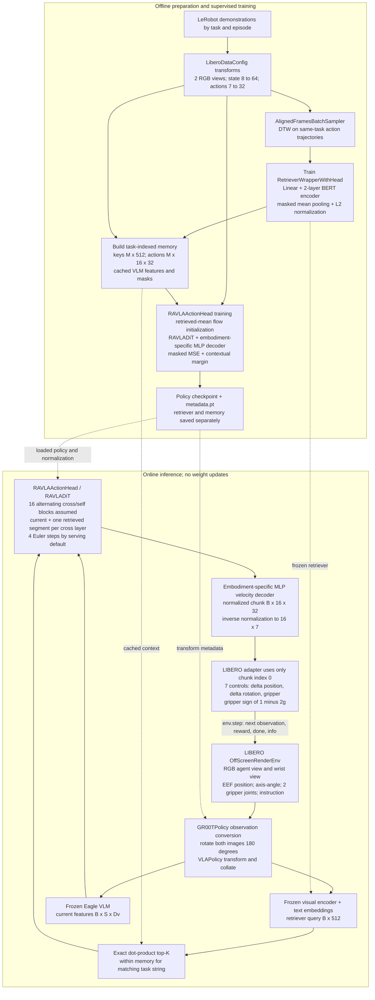
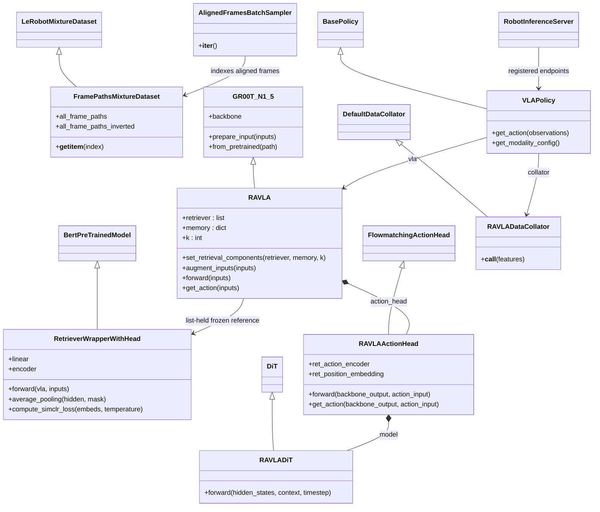

# RA-VLA code guide

This guide traces [ngocdaobao/RA-VLA](https://github.com/ngocdaobao/RA-VLA) at the user-selected N1.5 revision **`acb2a345c91af758f44643cedbc92dbe5d23c284`** (`first commit`, 22 September 2026). The local source is the [RA-VLA submodule](RA-VLA/README.md); the supplied paper is transcribed in [ravla.md](ravla.md). These are source-derived maintenance notes, not a claim that the release reproduces the paper’s scores. Review date: 22 October 2026.

The later `ebae2b6dffa619c080474975f97fd68bdd06f9bd` revision moves N1.5 code to `gr00t_old/` while RA-VLA scripts retain `gr00t.rag` imports. The chosen pin keeps the N1.5 module locations. Upstream source and documentation are unmodified. Commands, artifact locations and runtime prerequisites belong to this folder’s [README](README.md#operating-the-upstream-pipeline).

## Reading and maintenance contract

The architecture view shows data flow; the class, sequence and lifecycle views use UML expressed in Mermaid. Each diagram is embedded here and stored as editable `.mmd` source in `diagrams/`. Edit both copies together. File links refer to the pinned checkout. When changing the gitlink, re-trace the named symbols, update behavior, limitations and diagrams, and record the new full SHA. Preserve paper claims separately in `ravla.md`.

## End-to-end architecture

RA-VLA trains an action-aware retriever, builds a task-indexed cache, and fine-tunes the VLA action head. At test time it retrieves cached expert features/actions without updating weights. Retrieval uses current image/text inputs; proprioception enters the action head. The generative core is a **Diffusion Transformer (DiT) used for flow matching**, with MLP state/action projectors and velocity decoder.

[Editable Mermaid source](diagrams/01-system.mmd)



`B` is query batch size, `K` retrieval count, `M` segments in one task’s cache, `S` padded token count, `Dv` backbone feature width and `Dc` DiT cross-attention width. Hidden widths depend on checkpoint configuration; `EagleBackbone` defaults to a 2048-to-1536 projection. `LiberoDataConfig` fixes horizon 16, padded state width 64 and padded action width 32. Physical LIBERO state has 8 values; control has 7. The RA-VLA specialization assumes a 16-block interleaved DiT, despite different generic constructor defaults.

## Source map

| Source | Responsibility and principal symbols |
| --- | --- |
| [1_train_retriever.py](RA-VLA/scripts/rag/1_train_retriever.py) | `ArgsConfig`, `main`: sample paired trajectories, train retriever and save metadata/weights. |
| [2_build_memory.py](RA-VLA/scripts/rag/2_build_memory.py) | Select demonstrations/stride frames; cache task-keyed pixels, keys, actions, VLM features and masks. |
| [3_train_ravla.py](RA-VLA/scripts/rag/3_train_ravla.py) | Attach retriever/cache, initialize added weights, optimize action head and save epoch checkpoints. |
| [4_serve_ravla.py](RA-VLA/scripts/rag/4_serve_ravla.py) | Load checkpoint/normalizers/retriever/cache; construct `VLAPolicy` and ZeroMQ server. |
| [gr00t/rag/data.py](RA-VLA/gr00t/rag/data.py) | `FramePathsMixtureDataset`: integer-to-dataset/episode/frame mapping. `AlignedFramesBatchSampler`: aligned positive-pair batch ordering. |
| [gr00t/rag/retriever.py](RA-VLA/gr00t/rag/retriever.py) | `RetrieverWrapperWithHead`, `retrieve_from_memory`, `retrieve_from_memory_traj`: encoder, contrastive loss, exact task-local top-K. |
| [gr00t/rag/ravla.py](RA-VLA/gr00t/rag/ravla.py) | `RAVLADataCollator`, `RAVLA`, `RAVLAActionHead`, `RAVLADiT`: task extraction, context augmentation, loss, inference, layer schedule. |
| [gr00t/rag/policy.py](RA-VLA/gr00t/rag/policy.py) | `VLAPolicy`: input transforms/collation and inverse action transforms. `ReplayTrajPolicy` is auxiliary and unused by the four-stage path. |
| [gr00t/rag/utils.py](RA-VLA/gr00t/rag/utils.py) | DTW pairing, trajectory/frame selection, seeding and logging; optional k-medoids helpers. |
| [gr00t/model/gr00t_n1.py](RA-VLA/gr00t/model/gr00t_n1.py) | `GR00T_N1_5`: loading, device/dtype preparation, current-backbone execution and action-head dispatch. |
| [Eagle backbone](RA-VLA/gr00t/model/backbone/eagle_backbone.py) | Frozen vision/language feature production and projection. |
| [Parent flow-matching head](RA-VLA/gr00t/model/action_head/flow_matching_action_head.py) | Time sampling, embodiment-conditioned MLPs, action encoding and feature processing. |
| [Generic DiT](RA-VLA/gr00t/model/action_head/cross_attention_dit.py) | Attention blocks and timestep conditioning extended by `RAVLADiT`. |
| [LeRobot datasets](RA-VLA/gr00t/data/dataset.py) | Metadata, episode indexing, temporal padding, statistics, mixed normalization and video caching. |
| [Model transforms](RA-VLA/gr00t/model/transforms.py) | Eagle prompt/image processing, zero padding, channel masks and default collator. |
| [LIBERO config](RA-VLA/examples/Libero/custom_data_config.py), [modality mapping](RA-VLA/examples/Libero/modality.json) | Observation/action order, offsets, augmentation, normalization and physical channel slices. |
| [LIBERO evaluator](RA-VLA/examples/Libero/eval/run_libero_eval.py), [utilities](RA-VLA/examples/Libero/eval/utils.py) | Simulator observation conversion, first-action control, offscreen rendering, trial loops and MP4 recording. |
| [Robot RPC](RA-VLA/gr00t/eval/robot.py), [transport](RA-VLA/gr00t/eval/service.py) | ZeroMQ REQ/REP endpoints and MessagePack/NumPy serialization. |

## UML class relationships

[Editable Mermaid source](diagrams/02-classes.mmd)



The retriever is held in a Python list (`self.retriever = [retriever]`), not registered as a child `nn.Module`. It is called under `no_grad` during augmentation and excluded from the policy optimizer/state dict. Memory is an ordinary tensor dictionary, supplied externally. A policy checkpoint alone is therefore insufficient for serving.

## Data and tensor contracts

| Boundary | Actual contract |
| --- | --- |
| Raw input to `VLAPolicy` | `video.image` and `video.wrist_image` RGB arrays `[1,H,W,3]`; six scalar pose fields `[1,1]`; `state.gripper` `[1,2]`; one-element task-description list. |
| Pose semantics | EEF position plus **axis-angle rotation vector**. The evaluator stores rotation-vector components under names `roll`, `pitch`, `yaw`; the values are not Euler angles. |
| Timing | Observation offset `[0]`; target action offsets `[0,...,15]` from the same base frame. There is no longer observation history. |
| Video transforms | Tensor conversion, 0.95 crop, 224×224 resize, training color jitter, NumPy conversion, agent-view then wrist-view concatenation; Eagle performs further model-specific processing. Evaluation transforms are set to `eval()`. |
| Normalization | Default min/max for state and actions. `LiberoDataConfigMeanStd` offers mean/std for six non-gripper actions. Scripts hard-code config constants rather than expose a data-config CLI flag. |
| Model inputs | State `[B,1,64]` with 8 real channels; actions `[B,16,32]` with 7 real channels; channel masks; Eagle token IDs, image tensors, attention mask and embodiment ID `new_embodiment`. |
| Retriever | Unit embeddings `[B,512]` by script defaults. Frozen image features replace image-token slots in text embeddings **before** the LLM. Trainable linear projection, 2-layer BERT encoder, masked average pooling, L2 normalization follow. |
| Retrieved batch | Actions `[B*K,16,32]`; keys `[B*K,512]`; features `[B*K,Sret,Dv]` and left-padded masks `[B*K,Sret]`. |
| DiT context | Current VLM features concatenated with one ranked retrieved segment’s VLM features and 16 action tokens at each cross-attention block. State and current action tokens form the query sequence. |
| Policy output | Normalized `[B,16,32]`; wrapper takes batch element 0, trims padding, inverses normalization and returns seven component arrays over 16 timesteps. |
| Environment control | `[dx,dy,dz,drot_x,drot_y,drot_z,gripper]` at chunk index 0. Gripper becomes `sign(1-2g)`. RA-VLA delegates execution to the environment’s configured controller. |

Windows stay within episodes. Video indices clamp to boundary frames; state/action padding repeats boundary values for absolute fields and uses zeros for relative fields. `GR00TTransform` masks padded **channels**, but adds no temporal-validity mask for action targets beyond episode end. This differs from the parent project’s temporal masking requirement. Upstream is preserved; future local training integration must address it.

Scripts do not construct train/validation or held-out-task splits. They consume caller-provided dataset paths and save merged statistics. Prepare task/episode splits externally. Memory construction reloads retriever metadata; policy training recomputes metadata from its input mixture, so keep the normalizers compatible.

## Stage 1: retriever training

[Editable Mermaid source](diagrams/03-retriever-training.mmd)

```mermaid
sequenceDiagram
  participant CLI as 1_train_retriever.main
  participant DS as FramePathsMixtureDataset
  participant SAM as AlignedFramesBatchSampler
  participant DTW as get_aligned_frame_ids
  participant COL as DefaultDataCollator
  participant VLA as Frozen GR00T / Eagle
  participant RET as RetrieverWrapperWithHead
  participant OPT as AdamW and cosine scheduler
  CLI->>DS: Create cached datasets; merge and save metadata
  CLI->>SAM: num_trajs, num_frames, num_iterations
  loop Each configured iteration
    SAM->>DS: Select tasks and two trajectories per selected task
    SAM->>DTW: Action trajectories from the same task
    DTW-->>SAM: DTW pairs; unique first index; sample ordered frame pairs
    SAM-->>DS: Indices ordered as first views then paired second views
    DS->>COL: Transformed frames
    COL-->>CLI: Batch with 2 * num_trajs * num_frames samples
    CLI->>RET: forward(vla, batch)
    RET->>VLA: Vision features and text input embeddings under no_grad
    VLA-->>RET: Image-token slots replaced by visual embeddings
    RET->>RET: Linear, BERT encoder, masked mean, L2 normalize
    RET-->>CLI: Unit keys Z with shape batch x 512
    CLI->>RET: compute_simclr_loss(Z, temperature)
    RET->>RET: logits = Z Z transpose / temperature; mask diagonal
    RET->>RET: Positive target = index shifted by half a batch
    RET-->>CLI: Cross-entropy scalar
    CLI->>OPT: Backward; clip; step; scheduler; zero gradients
  end
  CLI->>RET: save_pretrained(retriever_path)
```

`AlignedFramesBatchSampler` distributes `num_trajs` across datasets, samples that many distinct tasks per dataset, and chooses two trajectories per task. Despite its name, `num_trajs` effectively counts **trajectory pairs / selected tasks**. Each selected task needs two demonstrations; each pair needs at least `num_frames` distinct first-side DTW indices. Random task allocation can exceed the available task count if inputs are unsuitable.

DTW uses raw multi-dimensional action sequences. `get_aligned_frame_ids` keeps only the first match for each first-side frame, samples pairs without replacement and preserves order. The batch concatenates all first-side samples, then their paired second-side samples. Contrastive labels are indices rolled by half the batch; this loss depends on that layout. Every non-self, non-positive sample is a negative, even when behavior might be similar.

Only the retriever’s linear projection and BERT encoder are optimized. Vision/text input embeddings are extracted under `torch.no_grad()`. The loop uses AdamW, a cosine schedule and gradient clipping. Saved outputs are HF configuration/weights, `metadata.pt` and `messages.log`; there is no validation report or optimizer-resume checkpoint.

## Stage 2: expert memory

[Editable Mermaid source](diagrams/04-memory-build.mmd)

```mermaid
sequenceDiagram
  participant CLI as 2_build_memory.main
  participant DS as LeRobotMixtureDataset
  participant KEY as get_key_frames
  participant COL as DefaultDataCollator
  participant RET as Frozen retriever
  participant VLM as Frozen GR00T backbone
  participant MEM as memory dictionary
  CLI->>DS: Load datasets and retriever metadata
  CLI->>DS: transforms.eval; last GR00TTransform.train
  loop Every dataset and task description
    CLI->>KEY: Select N trajectories, default random; sample stride frames
    KEY->>DS: get_step_data(trajectory, frame) and transforms
    KEY-->>CLI: Key frames with action chunks
    loop Batches of at most 100 key frames
      CLI->>COL: Collate key frames
      COL-->>CLI: Pixels, language tokens, normalized action chunks
      CLI->>RET: Encode unit keys without gradients
      RET-->>CLI: keys M_batch x 512
      CLI->>VLM: Encode each segment independently without gradients
      VLM-->>CLI: backbone_features and backbone_attention_mask
      CLI->>MEM: Append pixels, actions, keys, features, masks
    end
    CLI->>MEM: Concatenate each list; memory[task] = tensors
  end
  CLI->>MEM: torch.save to retriever_path / memory_name.pt
```

Default selection is 3 demonstrations/task and stride 4, including segment starts near episode ends. The builder calls `transforms.eval()` then re-enables only the final `GR00TTransform` training mode, retaining action fields without re-enabling image augmentation. Each segment is encoded independently in batches of at most 100.

| `memory[task]` field | Meaning |
| --- | --- |
| `keys` | `[M,512]`, normalized retrieval embeddings. |
| `pixel_values` | `[M,2,...]`, Eagle image tensors; the builder explicitly unflattens to two views. |
| `action` | `[M,16,32]`, normalized, channel-padded expert action chunks. |
| `backbone_features` | `[M,S,Dv]`, precomputed frozen VLM outputs. |
| `backbone_attention_mask` | `[M,S]`, token mask saved beside features. |

The actual cache **does not store expert proprioceptive state**, although paper Section 4.1 describes `(H′,s′,A′)`. Inference uses current proprioception and retrieved features/actions. The helper also returns pixels and keys that `RAVLA.augment_inputs` discards; they still occupy cache memory.

Search is exact `query @ memory[task]["keys"].T`, then sorted top-K. With unit embeddings, this is cosine ranking. It searches **within the task-description key**, not across all tasks; there is no ANN index. Missing task strings raise a key error, fewer than K entries cause top-K failure, and duplicate task strings in later datasets overwrite earlier entries. No selected trajectory/segment IDs are saved.

Feature batches are concatenated with `torch.cat`, so token lengths must match across batches for a task. Padding during retrieval cannot repair an incompatible cache at build time. Non-default dynamic image tiling also needs care because the builder assumes two image tensors per sample.

## Stage 3: action-head training

[Editable Mermaid source](diagrams/05-policy-training.mmd)

```mermaid
sequenceDiagram
  participant CLI as 3_train_ravla.main
  participant MODEL as RAVLA
  participant RET as Frozen retriever and task memory
  participant VLM as Frozen Eagle backbone
  participant HEAD as RAVLAActionHead
  participant DIT as RAVLADiT
  participant OPT as AdamW
  CLI->>MODEL: Load base checkpoint; attach retriever/cache; init new weights
  loop Epochs and shuffled full batches
    CLI->>MODEL: forward(current frames and expert actions)
    MODEL->>RET: Query key; task-local exact top-K
    RET-->>MODEL: K action chunks and cached feature tensors
    MODEL->>VLM: Current multimodal input
    VLM-->>HEAD: Current features and mask
    MODEL->>HEAD: State, target actions, masks, retrieved context
    HEAD->>HEAD: A0 = mean of K retrieved action chunks
    HEAD->>HEAD: Sample t; At = t Aexpert + (1-t) A0; target v = Aexpert - A0
    HEAD->>HEAD: Encode state, future tokens, noisy and retrieved actions
    HEAD->>DIT: Relevant context forward
    DIT-->>HEAD: Hidden states to velocity decoder
    HEAD->>DIT: Same current inputs; context rolled by K rows
    DIT-->>HEAD: Irrelevant-context hidden states to decoder
    HEAD->>HEAD: Channel-masked MSE and per-sample margin loss
    HEAD-->>CLI: loss = mse_loss + lambda * margin_loss
    CLI->>OPT: Backward; clip; step; scheduler; zero gradients
  end
  CLI->>MODEL: save_pretrained(checkpoint_epoch); save metadata
```

`RAVLA.augment_inputs` pops task labels, queries the frozen retriever, and appends retrieved actions plus `ret_backbone_output`. The inherited VLA forward encodes current image/language inputs and dispatches to `RAVLAActionHead`. Default loading freezes vision/LLM parameters and tunes projector/action-head modules and DiT.

For query b, flow initialization and training targets are:

$$
A_0^{(b)}=\frac{1}{K}\sum_{j=1}^{K} A_{\mathrm{ret},j}^{(b)},\quad
A_t=tA_{\mathrm{expert}}+(1-t)A_0,\quad
v=A_{\mathrm{expert}}-A_0.
$$

The parent head samples a beta-based time, then discretizes it into buckets. An embodiment-specific MLP embeds current state. Noisy-action encodings, future tokens and optional positional embeddings form query tokens. Retrieved actions have a separate linear encoder and learned horizon positions on the context side.

Two DiT evaluations share current input, timestep, target velocity and retrieved-mean initialization. The relevant pass uses retrieved context. The `ret_random=True` pass rolls all retrieved feature/action-token rows by K, giving each query another batch element’s context group. It neither independently samples a random cache segment nor changes the initialization prior.

Both MSEs use the action channel mask. Relevant MSE is reduced across valid entries; the margin uses per-sample masked MSE:

$$
L=\frac{\sum\mathrm{mask}(\hat v-v)^2}{\sum\mathrm{mask}}
+\lambda\,\operatorname{mean}_b\max(0,m-(\mathrm{MSE}_{r,b}-\mathrm{MSE}_{b})).
$$

Defaults are `margin=0.01`, `lambda_=0.1`. The retriever/cache receive no gradients. Checkpoints contain model weights/config and `metadata.pt`, without optimizer/scheduler resume state or validation-based selection.

### Pairwise grounding inside RAVLADiT

The implementation assumes 16 interleaved transformer blocks. Even indices cross-attend to `[current VLM tokens; selected retrieved VLM tokens; selected retrieved action tokens]`; odd indices self-attend. Later cross-attention blocks receive more relevant segments. The implemented zero-based schedule is:

| K | Rank index across 8 cross-attention blocks |
| --- | --- |
| 1 | `[0,0,0,0,0,0,0,0]` |
| 2 | `[1,1,1,1,0,0,0,0]` |
| 3 | `[2,2,1,1,1,0,0,0]` |
| 4 | `[3,3,2,2,1,1,0,0]` |

Rank 0 is most relevant. **Only K=1–4 is implemented**, while paper Table 5 also lists K=5–8. Other K values cause a lookup error. A changed block count or interleaving configuration requires revising the hard-coded schedule.

`RAVLADiT.forward` accepts current/retrieved attention masks but **does not pass them into cross-attention block calls**. Padding may affect predictions. Saved masks alone therefore do not establish attention masking correctness.

## Stage 4: serving and closed-loop control

[Editable Mermaid source](diagrams/06-online-control.mmd)

```mermaid
sequenceDiagram
  participant ENV as LIBERO OffScreenRenderEnv
  participant AD as GR00TPolicy adapter
  participant RPC as ZeroMQ REQ / REP
  participant POL as VLAPolicy
  participant MOD as RAVLA
  participant RET as Retriever and task memory
  participant HEAD as RAVLAActionHead and RAVLADiT
  AD->>ENV: reset; initial state; no-op settling steps
  loop Until done or step limit
    ENV-->>AD: Two RGB views, EEF pose, two gripper joints
    AD->>AD: Rotate RGB 180 degrees; quaternion to axis-angle; task text
    AD->>RPC: get_action(observation dictionary)
    RPC->>POL: Dispatch get_action
    POL->>POL: Checkpoint normalization; resize; concat; pad; collate
    POL->>MOD: get_action(normalized inputs)
    MOD->>RET: Query embedding and matching task description
    RET-->>MOD: Top-K actions and cached VLM features
    MOD->>HEAD: Current VLM features, state, retrieved context
    HEAD->>HEAD: Initialize action chunk from retrieved mean
    loop denoising_steps, serving default 4
      HEAD->>HEAD: DiT velocity conditioned on current and retrieved tokens
      HEAD->>HEAD: actions = actions + velocity / denoising_steps
    end
    HEAD-->>POL: Normalized chunk 1 x 16 x 32
    POL->>POL: Unapply transforms; trim padding; inverse normalization
    POL-->>RPC: Seven named action components for 16 timesteps
    RPC-->>AD: Action chunk
    AD->>AD: Select timestep 0; gripper = sign(1 - 2g)
    AD->>ENV: step(7-dimensional control)
    ENV-->>AD: Next observation, reward, done, info
    AD->>AD: Buffer both views for MP4
  end
  AD->>AD: Save side-by-side MP4 at 30 fps and success log
```

Serving loads checkpoint normalization, sets evaluation transforms, loads retriever/cache separately, and assigns the inference step count. `RAVLAActionHead.get_action` initializes with the retrieved mean and performs explicit Euler updates `A <- A + predicted_velocity / num_steps`. Serving defaults to four updates. The contextual-margin branch is training-only.

RPC uses ZeroMQ REP with `get_action` and `get_modality_config`, plus inherited `ping` and `kill`. MessagePack carries NumPy arrays as embedded `.npy` bytes. This is not HTTP. `VLAPolicy` processes one observation at a time and selects output batch element 0. Server defaults to port 8071; evaluation client defaults to 5555. Pass matching explicit ports.

The evaluator creates `OffScreenRenderEnv`, seeds it to zero, applies a predefined initial state, and waits for 10 no-op settling steps. It rotates both camera views 180 degrees, converts quaternion to axis-angle, requests a **fresh full 16-step chunk each environment step**, and executes **only chunk index 0**. It has no chunk buffer, multi-step open-loop execution or temporal ensembling.

`done` counts as success; returned reward/info do not provide a separate success check in this script. Recorded camera streams are joined side by side and encoded as MP4 at 30 fps; that encoding rate is not evidence of physical control frequency. `--headless` disables the OpenCV preview; simulation already uses an offscreen environment. Use a confirmed platform-compatible offscreen backend for any future evaluation.

Default 5 trials/task differs from the paper’s 50 LIBERO trials/task. Step limits are 220 (`libero_spatial`), 280 (`libero_object`), 600 (`libero_goal`), 1000 (`libero_10`), 400 (`libero_90`), plus settling steps. Logs overwrite `/tmp/logs/libero_eval_<suite>.log`; videos go into date-stamped `./rollouts` relative to the caller. Neither output root is a CLI argument.

## Artifact lifecycle and task splits

[Editable Mermaid source](diagrams/07-lifecycle.mmd)

```mermaid
stateDiagram-v2
  [*] --> DataPrepared
  DataPrepared --> RetrieverReady : Train retriever on training tasks
  RetrieverReady --> TrainingMemoryReady : Cache training-task segments
  TrainingMemoryReady --> PolicyReady : Train head with relevant and rolled contexts
  PolicyReady --> HeldOutMemoryReady : Cache held-out demos using fixed retriever and training normalization
  HeldOutMemoryReady --> Serving : Load policy, metadata, retriever and held-out memory
  Serving --> ActionRefinement : Observation and task request
  ActionRefinement --> Serving : Return decoded action chunk; no weight update
  Serving --> EvaluationRecorded : Complete episodes and save videos/logs
  EvaluationRecorded --> [*]
  note right of HeldOutMemoryReady
    Separate memory_name values preserve train/eval buffers.
    CLI scripts do not construct or enforce the task split.
  end note
```



Retriever/action-head optimization is offline supervised training. “Training-free adaptation” means serving a new task using demonstrations without parameter updates. The scripts do not automate the paper’s leave-one-suite/task-out experiments. Build a separate held-out serving memory using the fixed retriever and training normalizers; give it a distinct memory name to preserve the training cache.

| Artifact | Producer → consumer | Contract |
| --- | --- | --- |
| LeRobot dataset | External preparation → stages 1–3 / memory builder | Episode parquet, camera videos, `meta/info.json`, modality mapping, tasks/episodes and statistics. These scripts supply no raw-data conversion. |
| Dataset `.cache/frames.pt` | `CachedLeRobotSingleDataset` → data access | Potentially large camera-frame cache. The cache parent directory must exist. |
| Retriever directory | Stage 1 → stages 2–4 | HF config/weights, merged `metadata.pt`, `messages.log`. |
| `<memory_name>.pt` | Stage 2 → training or serving | Task-indexed tensor dictionary, saved inside retriever directory. |
| Policy output directory | Stage 3 → checkpoint selection | Initial metadata, messages log and epoch checkpoint directories. |
| `checkpoint_<epoch>` | Stage 3 → stage 4 | Policy weights/config plus normalization; no retriever/cache or optimizer resume state. |
| Episode MP4s and log | Evaluation client → result review | Execution evidence and success counts, distinct from paper-copy images. |

Keep memory, policy and retriever normalizers compatible. The scripts do not export a split manifest, selected buffer trajectory IDs or package-version manifest; a formal experiment must preserve these separately. Memory selection can change with seed and task order.

## Known source limitations and paper-to-code differences

| Finding | Consequence / maintenance action |
| --- | --- |
| Stage 1 hard-codes `examples.UR5e.custom_data_config:Ur5eDataConfig`, but `examples/UR5e` is absent. | Published default is blocked. Future authorized repair must expose/select the intended config or restore the adapter. There is no `--data-config` option. |
| This pin has no `pyproject.toml`, `setup.py`, dependency lock or full environment recipe. | Fresh checkout cannot meet the parent project’s editable-install rule by itself. Packaging/environment integration is separate work; do not inject `PYTHONPATH` or `sys.path`. |
| Upstream root README points to absent `eval_scripts/gr00t/run_libero_eval.py`. | Actual entry is `examples.Libero.eval.run_libero_eval`. The inherited LIBERO README also mentions absent generic GR00T scripts. |
| Training defaults to 3 epochs; serving defaults to `checkpoint_5`. | Pass an explicit checkpoint that exists. |
| Task extraction splits literal `<image-1><image-2>` and `<\|im_end\|>` chat tokens. | Camera count, template, language and memory keys must stay aligned. Template changes can break extraction or task lookup. |
| Task-local top-K and K=1–4 are assumed. | This is not unrestricted cross-task retrieval; changing K/topology needs coordinated code changes. |
| Rolled “irrelevant” context can still be relevant. | Batch size 1 does not change context; repeated tasks can produce accidental relevant negatives. Default batch size is 32, with incomplete batches dropped. |
| Only channel masks are built at episode boundaries. | Parent-project training integration needs temporal validity masks. |
| DiT ignores context attention masks. | Padded tokens may alter attention. |
| Retriever and policy stages can compute different merged statistics. | Reconcile mixtures/normalizers before using their caches together. |
| Cache omits expert state; paper lists K up to 8. | Use the implemented schema and K schedule for code maintenance, while retaining the paper formulation in `ravla.md`. |
| [Local Eagle config](RA-VLA/gr00t/model/backbone/eagle2_hg_model/config.json) names `Qwen/Qwen3-1.7B` and `eagle_2_5_vl`, while scripts load `nvidia/GR00T-N1.5-3B`. | Check backbone construction and weight compatibility during a separate runtime integration. The pin establishes module organization, not validated model-asset compatibility. |
| CUDA-oriented bf16 construction / FlashAttention configuration exist despite a CPU device fallback. | The fallback does not establish CPU or Windows compatibility. No device or simulator execution was validated here. |
| No UR5e acquisition/controller entry or complete RAEA/RICL training path is supplied. | The full real-robot/baseline experiments cannot be reconstructed from the four RA-VLA scripts alone. Auxiliary replay helpers are not complete baselines. |

These are documented upstream behaviors. This task adds a pinned submodule and code/paper documentation, without changing the parent project’s principles or creating a local experiment. Upstream source stays unchanged.

## Verification scope

Checks cover the pinned source’s call relationships, dataclass CLI definitions, static Python syntax, linked file/symbol existence, diagram source/embedded consistency, and gitlink SHA. The paper is checked for text coverage across all 18 pages, 11 figure crops, 5 tables and equations 1–10. No environment/packages, model weights or datasets were installed/downloaded for execution. No training, inference server or simulator was run; paper success rates are not fresh measurements.
